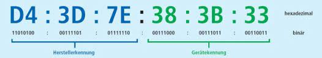

<!-- 
version:  0.0.1
language: de
narrator: Deutsch Female
persistent: true
author:  Lutz Herrmann

edit: true

tags: GK Informatik, Technische Informatik

comment: Aufgaben zum Thema Zahlsysteme im GK Informatik.

link:     https://cdn.jsdelivr.net/chartist.js/latest/chartist.min.css

script:   https://cdn.jsdelivr.net/chartist.js/latest/chartist.min.js
-->

# 1.1 Zahlsysteme - Aufgaben

## Aufgabe 1  
Wandeln Sie die folgenden Dualzahlen in Dezimalzahlen um:

1. (1011)₂ = [[11]]
2. (110010)₂ = [[50]]
3. (11111111)₂ = [[255]]
4. (10000001)₂ = [[129]]

## Aufgabe 2  
Wandeln Sie die folgenden Dezimalzahlen in Dualzahlen um:

1. 13 = ([[1101]])₂
2. 42 = ([[101010]])₂
3. 255 = ([[11111111]])₂
4. 128 = ([[10000000]])₂

## Aufgabe 3  
Wandeln Sie die folgenden Hexadezimalzahlen in Dezimalzahlen um:

1. (A3)₁₆ = [[163]]
2. (FF)₁₆ = [[255]] 
3. (1C)₁₆ = [[28]]
4. (7B)₁₆ = [[123]]

## Aufgabe 4 
Wandeln Sie die folgenden Dezimalzahlen in Hexadezimalzahlen um:

1. 75 = ([[4B]])₁₆
2. 200 = ([[C8]])₁₆
3. 255 = ([[FF]])₁₆
4. 1024 = ([[400]])₁₆

## Aufgabe 5  
Wandeln Sie die folgenden Dualzahlen in Hexadezimalzahlen um:

1. (1101 0011)₂ = ([[D3]])₁₆
2. (1111 1111)₂ = ([[FF]])₁₆
3. (1010 1100)₂ = ([[AC]])₁₆
4. (1 1110)₂ = ([[1E]])₁₆

## Aufgabe 6  
Wandeln Sie die folgenden Hexadezimalzahlen in Dualzahlen um (Eingabe ohne Leerzeichen):

1. (3F)₁₆ = ([[111111]])₂
2. (A7)₁₆ = ([[10100111]])₂
3. (5C)₁₆ = ([[1011100]])₂
4. (B2)₁₆ = ([[10110010]])₂

## Aufgabe 7

Für eine Webseite wurden folgende Farben ausgewählt. Die Angabe der Farben erfolgt im Hexadezimalsystem.

</img>

- a) Wandeln Sie die Angabe in einen RGB-Dezimalcode um und überprüfen Sie ihr Ergebnis mit Hilfe des [Links](https://www.w3schools.com/colors/colors_picker.asp) ((Eingabe ohne Leerzeichen).

        #FBE0C3 = ([[251,224,195]])

        #FFBB98 = ([[255,187,152]])

        #7D8E95 = ([[125,142,149]])

        #344648 = ([[52,70,72]]) 

- b) Wandeln Sie die Angaben in einen RGB-Dualcode um (Eingabe ohne Leerzeichen und mit führenden Nullen).

        ([[11111011,11100000,11000011]])

        ([[11111111,10101011,10001100]])

        ([[01111101,10001110,10010101]])

        ([[00110100,01000110,01001000]])

- c) Nennen Sie den Vorteil der Darstellung der Farben im Hexadezimalsystem.

 
## Aufgabe 8

In der Netzwerktechnik spielen MAC-Adressen von Netzwerkadaptern eine wichtige Rolle. In ihr ist der Hersteller der Karte hinterlegt.

- a) Wandeln Sie die obige MAC-Adresse in eine Binäreadresse um. (Eingabe ohne Leerzeichen)

        D4:3D:7E:38:3B:33 = [[11010100:00111101:01111110:00111000:00111011:00110011]]

- b) Bestimmen Sie mit Hilfe des [Links](https://www.dein-ip-check.de/tools/macfinder) den Hersteller!

Antwort anzeigen

Micro-Star Int'l Co, Ltd

## Aufgabe 9

- a) Bestimmen Sie die größte Zahl die sich mit 4 Ziffern für das Binär- und Hexadezimalsystem ergibt.
	- ([[1111]])₂ bzw. ([[FFFF]])₁₆

- b) Berechnen Sie die entsprechenden Werte im Dezimalsystem.
    - [[128]] bzw. [[65535]]

- c) Definieren Sie einen Zusammenhang zwischen der Basis des Zahlensystems und der Anzahl der darstellbaren Werte im Dezimalsystem.

## Zusatzaufgabe
In welchem Zahlensystem stellt die folgende Gleichung eine wahre Aussage dar?

$42 + 242 = 16^2$

$\rightarrow$ im [[8]]er-System

