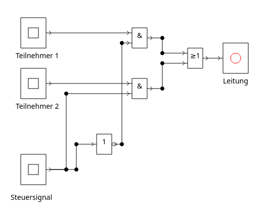
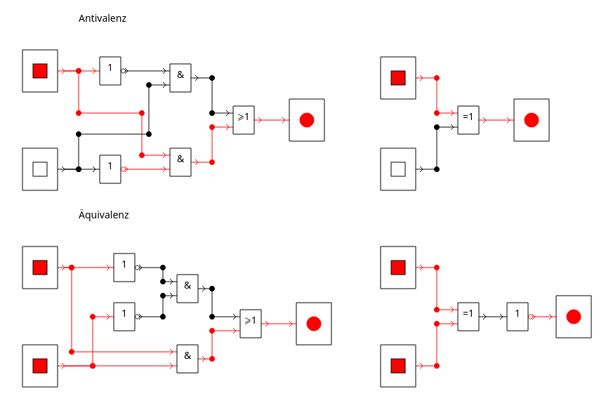

<!-- 
version:  0.0.1
language: de
narrator: Deutsch Female
persistent: true
author:  Lutz Herrmann

edit: true

tags: GK Informatik, Technische Informatik

comment: Aufgaben zum Thema Erstellen von Schaltnetzen im GK Informatik.

link:     https://cdn.jsdelivr.net/chartist.js/latest/chartist.min.css

script:   https://cdn.jsdelivr.net/chartist.js/latest/chartist.min.js

-->

# 1.2.1 Erstellen von Schaltnetzen - Aufgaben

Auf dieser Seite finden Sie Aufgaben zum Thema Erstellen von Schaltnetzen für den Informatik GK Klasse 11 - Sachsen mit interaktiver Lösungseingabe bzw. Anzeigemöglichkeit der Lösung.

## Aufgabe 1

Arbeiten Sie im Lehrbuch https://inf-schule.de/ den [Abschnitt zum Umgang mit DSimWeb](https://inf-schule.de/rechner/digitaltechnik/Simulatoren/DSimWeb/Schaltungen_aufbauen_und_simulieren)
durch und lösen Sie die Aufgabe.

[[!]]

****************************************

<a href="./material/Aufgabe01SchaltnetzErstellen.json" download>
  Jsondatei herunterladen
</a>

****************************************

## Aufgabe 2

Erstellen  Sie die logischen Verknüpfungen 

- Antivalenz (XOR) : $X = (\overline A \wedge B) \vee (A \wedge \overline B)$ bzw.  $X = A \nsim B$ oder $X= A \nleftrightarrow B$ und 
- Äquivalenz: (XNOR oder NOT XOR) $X= (\overline A \wedge \overline B) \vee (A \wedge B)$ bzw. $X = A \sim B$ oder $X = A \leftrightarrow B$

in DSimWeb mit den logischen Funktionen AND, OR und NOT. Bauen Sie jeweils zum Vergleich noch eine Schaltung mit den eigentlichen Schaltsymbolen der Antivalenz und der Äquivalenz auf.

[[!]]

****************************************

<a href="./material/Aufgabe02SchaltnetzeErstellen.json" download>
  Jsondatei herunterladen
</a>

****************************************