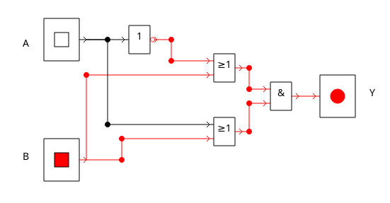
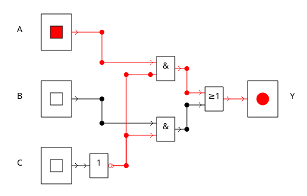
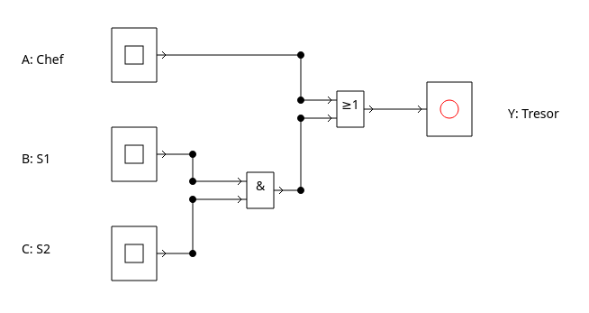

<!-- 
version:  0.0.1
language: de
narrator: Deutsch Female
persistent: true
author:  Lutz Herrmann

edit: true

tags: GK Informatik, Technische Informatik

comment: Aufgaben zum Thema Schaltnetzanalyse im GK Informatik.

link:     https://cdn.jsdelivr.net/chartist.js/latest/chartist.min.css

script:   https://cdn.jsdelivr.net/chartist.js/latest/chartist.min.js

-->

# 1.2.2 Schaltnetzanalyse - Aufgaben

Auf dieser Seite finden Sie Aufgaben zum Thema Schaltnetzanalyse für den Informatik GK Klasse 11 - Sachsen mit interaktiver Lösungseingabe bzw. Anzeigemöglichkeit der Lösung.

## Aufgabe 1

Gegeben ist das folgende Schaltnetz!

- a) Analysieren Sie die folgende Schaltung und Erstellen Sie eine Wahrheitstabelle! Setzen Sie dazu eventuell Zwischenpunkte!

[[!]]

****************************************

| $A$ | $B$ | $A \vee B$ | $\overline A \vee B$ | $(A \vee B) \wedge (\overline A \vee B)$ |
| --- | --- | ---------- | -------------------- | ---------------------------------------- |
| 0   | 0   | 0          | 1                    | 0                                        |
| 0   | 1   | 1          | 1                    | 1                                        |
| 1   | 0   | 1          | 0                    | 0                                        |
| 1   | 1   | 1          | 1                    | 1                                        |
****************************************

- b) Ermitteln Sie den Boolschen Ausdruck, der die Schaltung beschreibt!

[[!]]

****************************************
$Y = (A \vee B) \wedge (\overline A \vee B)$
****************************************

- c) Ermitteln Sie die disjunktive Normalform der Schaltung und vergleichen Sie si mit dem Ergebnis von b)

[[!]]

****************************************
$Y = (\overline A \wedge \overline B) \vee (A \wedge \overline B)$
****************************************

- d) Erstellen Sie die Schaltung in [DSimWeb](https://inf-schule.de/tools/dsim) und überprüfen Sie Ihre Ergebnisse!

## Aufgabe 2

Gegeben ist das folgende Schaltnetz.

- a) Analysieren Sie die folgende Schaltung und Erstellen Sie eine Wahrheitstabelle! Setzen Sie dazu eventuell Zwischenpunkte!

[[!]]

****************************************

| $A$ | $B$ | $C$ | $A \wedge \overline C$ | $B \wedge \overline C$ | $(A \wedge \overline C) \vee (B \wedge \overline C)$ |
| --- | --- | --- | ---------------------- | ---------------------- | ---------------------------------------------------- |
| 0   | 0   | 0   | 0                      | 0                      | 0                                                    |
| 0   | 0   | 1   | 0                      | 0                      | 0                                                    |
| 0   | 1   | 0   | 0                      | 1                      | 1                                                    |
| 0   | 1   | 1   | 0                      | 0                      | 0                                                    |
| 1   | 0   | 0   | 1                      | 0                      | 1                                                    |
| 1   | 0   | 1   | 0                      | 0                      | 0                                                    |
| 1   | 1   | 0   | 1                      | 1                      | 1                                                    |
| 1   | 1   | 1   | 0                      | 0                      | 0                                                    |

****************************************

- b) Ermitteln Sie zwei verschiedene Boolsche Ausdrücke, die die Schaltung beschreiben!

[[!]]

****************************************
	- $Y = (A \wedge \overline C) \vee (B \wedge \overline C)$
	- $Y = (\overline A \wedge B \wedge \overline C) \vee ( A \wedge \overline B \wedge \overline C) \vee (A \wedge B \wedge \overline C)$

****************************************
-  c) Erstellen Sie die Schaltung in [DSimWeb](https://inf-schule.de/tools/dsim) und überprüfen Sie Ihre Ergebnisse!

## Aufgabe 3

Die Firma Digitech hat sich zur Sicherung ihres Tresorraumes folgendes System überlegt: Der Geschäftsleiter besitzt einen Schlüssel, der ihn direkt öffnet. Die beiden Sicherheitsbeauftragten können den Tresorraum nur öffnen, wenn beide gleichzeitig aufschließen.   In unserem Schaltnetz soll der Geschäftsführer den Eingang A, die beiden Sicherheitsbeauftragten die Eingänge B und C haben. Der Ausgang Y soll nur dann leuchten, wenn der Tresorraum geöffnet wird.

- a) Erstellen Sie für die gegebene Situation eine Wahrheitstabelle.
- b) Finden Sie einen logischen Ausdruck, der die Schaltung beschreibt.$
- c) Erstellen Sie die Schaltung in [DSimWeb](https://inf-schule.de/tools/dsim) und überprüfen Sie sie mit Hilfe Ihrer Wahrheitstabelle!

[[!]]

****************************************
a)

| $A$ | $B$ | $C$ | $A \vee (B \wedge C)$ |
| --- | --- | --- | --------------------- |
| 0   | 0   | 0   | 0                     |
| 0   | 0   | 1   | 0                     |
| 0   | 1   | 0   | 0                     |
| 0   | 1   | 1   | 1                     |
| 1   | 0   | 0   | 1                     |
| 1   | 0   | 1   | 1                     |
| 1   | 1   | 0   | 1                     |
| 1   | 1   | 1   | 1                     |

b) 

$X=A \vee (B \wedge C)$
DNF: $X = (\overline A \wedge B \wedge C) \vee ( A \wedge \overline B \wedge \overline C) \vee ( A \wedge \overline B \wedge C) \vee ( A \wedge B \wedge \overline C) \vee ( A \wedge B \wedge C)$

c)

****************************************