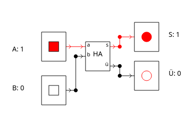
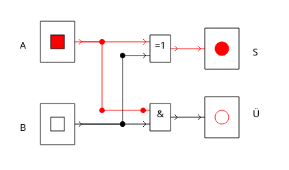
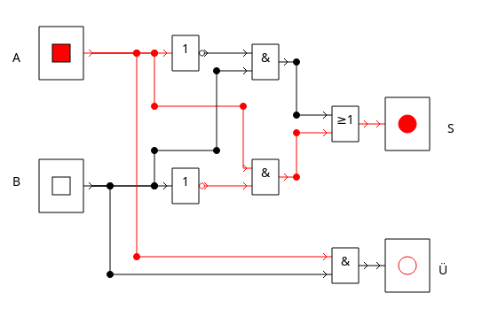
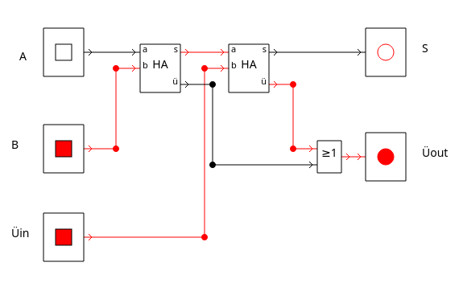

<!-- 
version:  0.0.1
language: de
narrator: Deutsch Female
persistent: true
author:  Lutz Herrmann

edit: true

tags: GK Informatik, Technische Informatik

comment: Aufgaben zum Thema Anwendungen zu Schaltnetzen im GK Informatik.

link:     https://cdn.jsdelivr.net/chartist.js/latest/chartist.min.css

script:   https://cdn.jsdelivr.net/chartist.js/latest/chartist.min.js

-->

# 1.2.3 Anwendungen zu Schaltnetzen - Aufgaben

Auf dieser Seite finden Sie Aufgaben zum Thema Anwendungen zu Schaltnetzen für den Informatik GK Klasse 11 - Sachsen mit interaktiver Lösungseingabe bzw. Anzeigemöglichkeit der Lösung.

## Aufgabe 1

Erstellen Sie mit den Halbaddersymbol in [DSimWeb](https://inf-schule.de/tools/dsim) eine Halbadderschaltung!

[[!]]

****************************************

****************************************

## Aufgabe 2

Erstellen Sie mit [DSimWeb](https://inf-schule.de/tools/dsim) eine Halbadderschaltung, indem Sie nur die Grundgatter (AND, OR, NOT) und XOR verwenden!

[[!]]

****************************************

****************************************

## Aufgabe 3

Erstellen Sie mit [DSimWeb](https://inf-schule.de/tools/dsim) eine Halbadderschaltung, indem Sie nur die Grundgatter (AND, OR, NOT)  verwenden!

[[!]]

****************************************

****************************************

## Aufgabe 4

Erstellen Sie mit  [DSimWeb](https://inf-schule.de/tools/dsim) eine Volladderschaltung. Sie können dazu Halbadder und die logischen Grundfunktionen verwenden! 

[[!]]

****************************************

****************************************

## Aufgabe 5

Mit der Addition lassen sich die anderen Grundrechenoperationen Subtraktion, Multiplikation und Division realisieren. Wie könnte man aus diesen Operationen die folgenden mathematischen Operationen realisieren:

[[!]]

****************************************
- Potenzieren
- Wurzelziehen
- Funktionen: Logarithmus, Winkelfunktionen usw.
****************************************