<!-- 
version:  0.0.1
language: de
narrator: Deutsch Female
persistent: true
author:  Lutz Herrmann

edit: true

tags: GK Informatik, Technische Informatik

comment: Aufgaben zum Thema Wiederholung algorithmische Grundstrukturen im GK Informatik.

link:     https://cdn.jsdelivr.net/chartist.js/latest/chartist.min.css

script:   https://cdn.jsdelivr.net/chartist.js/latest/chartist.min.js


-->

# 2.1.1 Aufgaben zur Wiederholung algorithmischer Grundstrukturen

Auf dieser Seite finden Sie Aufgaben zum Thema Wiederholung algorithmische Grundstrukturen für den Informatik GK Klasse 11 - Sachsen mit interaktiver Lösungseingabe bzw. Anzeigemöglichkeit der Lösung.


## Aufgabe 1

Die Fahrenheit-Temperaturskale wurde vom deutschen Physiker Daniel Gabriel Fahrenheit entwickelt. Als Fixpunkte verwendete er die Temperatur eines Gemischs aus Eis, Wasser und Salmiak, mit dem er eine Temperaur
von ca. -17,8°C erreichte. Diese Temperatur entspricht 0°F entspricht. Als zweiten Fixpunkt legte Fahrenheit den Gefrierpunkt von Wasser mit 32 °F (0°C) fest. Für die exakte Umrechnung verwendet heute man die folgende Formel

$$T_F=\left(T_C \cdot \dfrac{9}{5}\right) + 32$$

,wobei $T_C$ die Temperatur in °C und $T_F$ die Temperatur in °F ist.

  - a) Schreiben Sie ein Pythonprogramm, welches zunächst abfragt, ob Fahrenheit in Celsius, oder Celsius in Fahrenheit umgewandelt werden soll. Danach soll der jeweilige Temperaturwert eingegeben werden und das Ergebnis soll ausgegeben werden. Die Ergebnisse sollen auf eine Stelle nach dem Komma gerundet werden. Informieren Sie sich dazu über die Pythonfunktion `round()`!

[[!]]
<script>
  true;
</script>
****************************************
```python
print("Temperaturumrechnung")
print("********************")
print()
print("(1) - Fahrenheit -> Celsius")
print("(2) - Celsius -> Fahrenheit")
w = int(input("Deine Wahl: "))
if w == 1:
    f = int(input("Temperatur in F: "))
    c = (f-32)*5/9
    print("Temperatur in C: ",round(c,1))
else:
    c = int(input("Temperatur in C: "))
    f = (c*9/5)+32 
    print("Temperatur in F: ",round(f,1))
```
****************************************


  - b) Erweitern Sie ihr Programm aus Teilaufgabe a) so, dass nach jeder Ausgabe abgefragt wird, ob noch weitere Werte umgerechnet werden sollen. In diesem Fall soll das Programm wieder die Art der Umrechnung und den Wert abfragen.

[[!]]
<script>
  true;
</script>
****************************************
```python
print("Temperaturumrechnung")
print("********************")

while True:
    print()
    print("(1) - Fahrenheit -> Celsius")
    print("(2) - Celsius -> Fahrenheit")
    w = int(input("Deine Wahl: "))
    if w == 1:
        f = int(input("Temperatur in F: "))
        c = (f-32)*5/9
        print("Temperatur in C: ",round(c,1))
    else:
        c = int(input("Temperatur in C: "))
        f = (c*9/5)+32 
        print("Temperatur in F: ",round(f,1))
    print()
    n = input("Weitere Umrechnungen? (J/N)")
    if n == "N":
        break
```
****************************************


  - c) Verändern Sie ihr Programm aus Teilaufgabe b). An Stelle der einzugebenden Temperatur soll nun ein Startwert und ein Endwert der Temperatur als ganze Zahl eingegeben werden. Danach soll eine Tabelle ausgegeben werden, in deren ersten Spalte, je nach Auswahl, die Temperaturen vom Startwert bis zum Endwert in 1-Grad-Schritten stehen. In der zweiten Spalte steht die jeweils umgerechnete Temperatur auf eine Dezimalstelle genau. Über der Tabelle soll ein Tabellenkopf ausgegeben werden, der die Umrechnung beschreibt, also z.B. "Fahrenheit $\rightarrow$ Celsius".

[[!]]
<script>
  true;
</script>
****************************************
```python
print("Temperaturumrechnung")
print("********************")

while True:
    print()
    print("(1) - Fahrenheit -> Celsius")
    print("(2) - Celsius -> Fahrenheit")
    w = int(input("Deine Wahl: "))
    if w == 1:
        start = int(input("Startwert: "))
        ende = int(input("Endwert: "))
        print("Fahrenheit -> Celsius")
        for i in range(start, ende+1):
            print(i,"\t",round((i-32)*5/9,1))
    else:
        start = int(input("Startwert: "))
        ende = int(input("Endwert: "))
        print("Celsius -> Fahrenheit")
        for i in range(start, ende+1):
            print(i,"\t",round((i*9/5)+32,1))
    print()
    n = input("Weitere Umrechnungen? (J/N)")
    if n == "N":
        break
```
****************************************


## Aufgabe 2

Setzen Sie die folgenden Struktogramme in Pythonprogramme um!

- a) Dieser Algorithmus ermittelt die Quersumme einer natürlichen Zahl.

<br>



<br>

[[!]]
<script>
  true;
</script>
****************************************
```python
zahl = int(input("Zahl: "))
quersumme = 0
while zahl > 0:
    quersumme = quersumme + (zahl % 10)
    zahl = zahl - (zahl % 10)
    zahl = zahl // 10
print("Quersumme:",quersumme)
```
****************************************

<br>

  - b) Dieser Algorithmus testet von einer Zahl, ob sie eine Primzahl ist.

<br>


<br>

[[!]]
<script>
  true;
</script>
****************************************
```python
a = int(input("a = "))
z = 0
for i in range(1,a+1):
    if a % i == 0:
        z = z + 1
if z == 2:
    print("a ist Primzahl!")
else:
    print("a ist  keine Primzahl!")
```
****************************************

<br>

  - c) Dieser Algorithmus stellt eine Collatz-Folge grafisch dar.
https://de.wikipedia.org/wiki/Collatz-Problem

<br>


<br>

[[!]]
<script>
  true;
</script>
****************************************
```python
print("Collatz-Folge")

a = 1
b = 100
z = 1
for i in range(a,b):
    temp = i
    while temp > 1:
        if temp % 2 == 0:
            temp = temp // 2
            z = z + 1
        else:
            temp = 3 * temp + 1
            z = z + 1
    zk = str(i)+": "
    for k in range(z):
        zk = zk + "*"
    print(zk)
    z = 1
```
****************************************

<br><br><br>

## Aufgabe 3

Setze das folgende Pythonprogramm in einem Struktogramm um!

https://ddi.education/struktog/

```python
# Aufgabe 3

while True:
    a=float(input("a = "))
    b=float(input("b = "))
    c=float(input("c = "))
    if (a+b>c) and (a+c>b) and (b+c>a):
        if (a==b) or (a==c) or (b==c):
            if (a==b) and (a==c):
                print("Es liegt ein gleichseitiges Dreieck vor.")
            else:
                print("Es liegt ein gleichschenkliges Dreieck vor.")
        else:
            print("Es liegt ein allgemeines Dreieck vor.")
    else:
        print("Es liegt kein Dreieck vor.")
    w = input("Nochmal? (J/N)")
    if w == "N":
        break

```

<details>
<summary>Antwort anzeigen</summary>

</details>