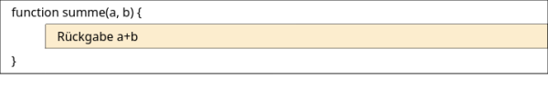
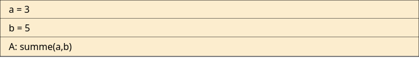

<!-- 
version:  0.0.1
language: de
narrator: Deutsch Female
persistent: true
author:  Lutz Herrmann

edit: true

tags: GK Informatik, Programmieren in Python

comment: Aufgaben zum Thema Wiederholung Funktionen im GK Informatik.

link:     https://cdn.jsdelivr.net/chartist.js/latest/chartist.min.css

script:   https://cdn.jsdelivr.net/chartist.js/latest/chartist.min.js

import: https://raw.githubusercontent.com/LiaTemplates/Pyodide/master/README.md
-->

# 2.3.1 Wiederholung Funktionen

Siehe: https://www.herrmix.de/dokuwiki/doku.php?id=neuerlehrplan:klasse10:funktionen

## Definition und Aufruf einer Funktion

**Definition**

```python
def meineFunktion():
    ...Anweisungen...
```

**Aufruf**

```python
...Anweisungen...
meineFunktion()
...Anweisungen...
```

**Beispiel:**

```python
def trennlinie():
    print("###############################################")

trennlinie()
name = input("Dein Name: ")
trennlinie()
print("Hallo",name,"du hast einen schönen Namen")
trennlinie()


```
@Pyodide.eval

Ausgabe des Beispiels:

```
###############################################
Dein Name: Obiwan Kenobi
###############################################
Hallo Obiwan Kenobi du hast einen schönen Namen
###############################################
```

## Lokale und globale Variablen

Wir betrachten das folgende Pythonprogramm:

```python
def test():
    i=3
    print("Wert von i:",i)

#Hauptprogramm
i=5
print("Wert von i:",i)
test()
print("Wert von i:",i)
```
@Pyodide.eval

bei der Ausgabe des Programms ergibt sich das Folgende:

```
Wert von i: 5
Wert von i: 3
Wert von i: 5
```


> [!NOTE] Globale Variable:
> Variable, die im Hauptprogramm definiert wird.


> [!NOTE] Lokale Variable:
> Variable, die in einer Funktion definiert wird.

**Beispiel:**

```python
def funktion():
    global g # Zugriff auf globale Variable
    l = 3 # lokale Variable
    g = g + 3 # g wird um 3 erhöht
    print(l+g)

g = 3 # Definition globale Variable

funktion() # Ausgabe 9
```
@Pyodide.eval

### Vor- und Nachteile lokaler und globaler Variablen

|                       | **Vorteile**                                    | **Nachteile**                                      |
| --------------------- | ----------------------------------------------- | -------------------------------------------------- |
| **globale Variablen** | Speicherplätze werden nicht unnötig belegt.<br> | Speicherplätze werden auf Dauer belegt.            |
| **lokale Variablen**  | Variablen stehen überall zur Verfügung.         | Variablen stehen nur in der Funktion zur Verfügung |

## Funktionen mit Parametern und Rückgabewerten

### Parameter

**Beispiel:**

```python
def summe(a,b):
    print("Summe von",a,"und",b,":",a+b)

summe(3,4)
x=8
y=9
summe(x,y)
```
@Pyodide.eval

**Ausgabe:**

```
Summe von 3 und 4 : 7
Summe von 8 und 9 : 17
```

### Rückgabewerte

**Beispiel:**

```python
def summe(a,b):
    return a+b

x = 3
y = 4
s = summe(x,y)
print("Die Summe von",x,"und",y,"ist",s,".")

n = 8
m = 9
print("Die Summe von",n,"und",m,"ist",summe(n,m),".")
```
@Pyodide.eval

**Ausgabe:**

```
Die Summe von 3 und 4 ist 7 .
Die Summe von 8 und 9 ist 17 .
```

### Vorbelegung der Parameter

**Beispiel:**

```python
def summe(a = 0 ,b = 1):
    return a+b

print(summe())
print(summe(3))
print(summe(3,4))
```
@Pyodide.eval

**Ausgabe:**

```
1
4
7
```

**Beispiel:**

```python
def summe(a ,b = 1):
    return a+b

print(summe(3))
print(summe(3,4))
```
@Pyodide.eval

**Ausgabe:**

```
4
7
```
## Darstellung einer Funktion im Struktogramm

Der Algorithmus einer Funktion wird in einem Extra-Struktogramm dargestellt.



Im Hauptprogramm wird dann der Funktionsaufruf als Befehl angegeben.



## Vordefinierte Funktionen, Module

**Moduele:**

```python
# Zugriff auf alle enthaltenden Funktionen
import module
module.function_name() #Aufruf der Funktion über Punktnotation

from module import *
function_name() #Aufruf der Funktion

#Es auch nur einzelne Funktionen eines Moduls importieren:
from module import function_name
function_name()
```

**Eigene Module:**

```python
# Beispiel für ein einfaches Modul namens "mein_modul.py"
def sag_hallo(name):
    print("Hallo, " + name + "!")

# Anwendung des Moduls in einem anderen Skript
import mein_modul

mein_modul.sag_hallo("Python")
    
```